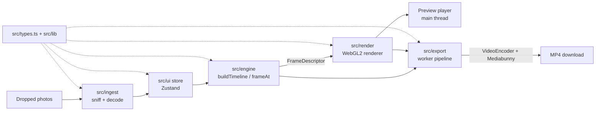

# Montage: onboarding guide

> Generated from the Understand-Anything knowledge graph at commit `1ee6482` (30 October 2026).
> Regenerate with `/understand` then `/understand-onboard` when the architecture changes.

## 1. Project overview

**Montage** is a client-side web app that turns a set of photos into an H.264 MP4 montage, entirely in the
browser. It has no backend: photos never leave the visitor's machine. Live at
https://grahamlehr.github.io/montage/.

|                        |                                                                                                                                     |
| ---------------------- | ----------------------------------------------------------------------------------------------------------------------------------- |
| **Languages**          | TypeScript (strict), CSS, HTML, plus JSON/YAML/Markdown/shell for config, CI and docs                                               |
| **Frameworks**         | React 19, Zustand, Vite, Vitest, Playwright, ESLint, Prettier, GitHub Actions                                                       |
| **Key libraries**      | Mediabunny (MP4 muxing), WebCodecs `VideoEncoder` (H.264), WebGL2 (rendering), `heic-to` (HEIC fallback), dnd-kit (tray reordering) |
| **Supported browsers** | Latest desktop Google Chrome or Microsoft Edge. Both ship the WebCodecs H.264 encoders                                              |
| **Size**               | 156 analysed files: 122 code, 9 config, 8 docs, 3 CI workflows, 12 markup, 2 scripts                                                |

The spec and agreed plan live in **`PLAN.md`**; working rules and invariants are in **`AGENTS.md`**. Read both
before changing anything structural.

### Getting running

```bash
npm ci
npm run dev        # app at http://localhost:5173, harness pages at /harness/<module>.html
npm test           # Vitest unit tests
npm run test:e2e   # Playwright, in installed Google Chrome (not bundled Chromium)
```

`npm run lint`, `npm run typecheck`, `npm test` and `npm run build` must all pass before a PR is done.

## 2. How the pieces fit together



The same engine and renderer drive both the live preview and the export. That is why what you see in the
preview matches the exported file frame for frame.

## 3. Architecture layers

| Layer                                | What belongs here                                                                                                       | Key files                                                                                                |
| ------------------------------------ | ----------------------------------------------------------------------------------------------------------------------- | -------------------------------------------------------------------------------------------------------- |
| **Shared Contract & Core Utilities** | The `src/types.ts` contract plus `src/lib` constants and the seeded RNG that every module imports.                      | `src/types.ts` (imported by 51 files), `src/lib/constants.ts` (27), `src/lib/rng.ts` (10)                |
| **Photo Ingest**                     | Sniffs file formats, decodes photos to upright, size-fitted `ImageBitmap`s and classifies errors.                       | `src/ingest/sniff.ts`, `decode.ts`, `size.ts`, `errors.ts`                                               |
| **Timeline Engine**                  | Pure, seeded timeline logic, guarded by golden JSON fixtures.                                                           | `src/engine/timeline.ts`, `frame.ts`, `pacing.ts`, `grouping.ts`, `layouts.ts`, `styles.ts`, `motion.ts` |
| **Renderer & Transitions**           | A WebGL2 canvas renderer that draws a `FrameDescriptor`, with layout maths and GLSL transitions.                        | `src/render/renderer.ts`, `layout.ts`, `transitions/index.ts`, `transitionSpec.ts`                       |
| **Video Export**                     | WebCodecs and Mediabunny H.264 encoding in a worker, with frame sources, encoder selection and residency.               | `src/export/pipeline.ts`, `worker.ts`, `client.ts`, `montageSource.ts`, `encoderConfig.ts`, `avc.ts`     |
| **Editor UI & State**                | The React editing panels plus the Zustand store and pure UI logic.                                                      | `src/ui/store.ts`, `logic.ts`, `SettingsPanel.tsx`, `PhotoTray.tsx`, `PerPhotoInspector.tsx`             |
| **App Shell & Integration**          | Entry point, the root `App`, preview playback, the export bar, staging, browser gate, tour and consent-gated analytics. | `src/main.tsx`, `src/app/App.tsx`, `previewEngine.ts`, `PreviewPlayer.tsx`, `ExportBar.tsx`              |
| **Harnesses & End-to-End Tests**     | Dev-only harness pages for each module, plus Playwright specs with ffprobe and frame helpers.                           | `harness/*.html` + `*.ts`, `tests/e2e/*.spec.ts`, `tests/e2e/helpers/*`                                  |
| **Build, Config & CI**               | Vite, TypeScript, ESLint, Prettier and Playwright config; CI, Pages deploy and secret scanning; hooks and scripts.      | `vite.config.ts`, `eslint.config.js`, `playwright.config.ts`, `.github/workflows/*`                      |
| **Documentation**                    | The spec, agent rules, decision log, handoff notes and proposals.                                                       | `PLAN.md`, `AGENTS.md`, `README.md`, `docs/proposals/multi-photo-shots.md`                               |

**Dependency direction:** the app shell depends on everything below it. Export depends on the engine, ingest and
render. Every layer depends on the shared contract, which itself imports nothing. Harnesses and e2e tests import
from `src`, but nothing in `src` imports them.

## 4. Key concepts

1. **`src/types.ts` is the contract.** Settings, photo sources, segments, shots, layers, `FrameDescriptor`,
   the renderer interface and export messages are all defined here. Import from it and never redefine its types.
   A change here ripples into more than 50 files, so treat it as a contract change (see the multi-photo-shots
   proposal for how one was planned).
2. **The engine is pure and deterministic.** `buildTimeline()` and `frameAt()` give identical output for
   identical photos, settings and seed. All randomness goes through `src/lib/rng.ts` (`mulberry32`,
   `deriveSeed`, `pick`, `shuffle`). ESLint bans `Math.random()` and `Date.now()` in `src/engine` and
   `src/render`.
3. **The renderer only draws.** It receives a `FrameDescriptor` and paints it. All decisions about timing,
   style and layout are made in the engine first.
4. **Golden fixtures guard regressions.** `golden-v1.json` and `golden-noloop.json` pin engine output. If a
   change alters them, it changes existing users' montages, so it needs a deliberate decision.
5. **Shots, not just photos.** A shot can hold one to four photos (single, duo, trio, quad, picture-in-picture,
   polaroid). `grouping.ts` decides the groups and `layouts.ts` places the cells. With grouping off, output must
   stay pixel-identical to the original single-photo renderer (`harness/render.v1.ts` is the frozen reference).
6. **Export runs off the main thread.** `client.ts` starts a worker. `pipeline.ts` draws each frame to an
   `OffscreenCanvas`, encodes it with `VideoEncoder` and muxes the result with Mediabunny. It handles
   backpressure and cancellation, and if a hardware encoder fails partway through it restarts with the next
   preference (`prefer-hardware` → `no-preference` → `prefer-software`).
7. **`FrameSource` decouples export from content.** The pipeline only sees the `FrameSource` interface. In
   production that is `montageSource.ts`; in tests and harnesses it is the deterministic test pattern.
8. **Residency keeps memory bounded.** `residency.ts` decides which shots and photos stay decoded. Both the
   preview engine and the export source use it.
9. **Encoder limits are real.** H.264 in Chrome caps the frame area at 36,864 macroblocks (about 9.4 MP, such as
   4096×2304). `constants.ts` and `ui/logic.ts` clamp sizes to that cap, and `avc.ts` picks the lowest H.264 level
   that fits.
10. **Settings are staged.** Form edits only reach the preview and export when the user presses **Rebuild**.
    `loop` is the one exception and applies immediately (`src/app/staging.ts`).
11. **Resources must be released.** Every `VideoFrame` and `ImageBitmap` must be `.close()`d.
12. **Privacy by design.** Analytics loads only in production builds and only after consent. It never sends file
    names or image data.

## 5. Guided tour

Follow these in order; each builds on the last.

| #   | Step                                                                                                                                                              | Read                                                                                     |
| --- | ----------------------------------------------------------------------------------------------------------------------------------------------------------------- | ---------------------------------------------------------------------------------------- |
| 1   | **Entry point and overview.** `index.html` loads `main.tsx`, which loads fonts and theme CSS, initialises analytics and mounts `App`.                             | `src/main.tsx`, `index.html`, `README.md`                                                |
| 2   | **The app shell.** `App.tsx` connects ingest, the store, timeline building, preview and export. Staged settings live in `staging.ts`.                             | `src/app/App.tsx`, `staging.ts`, `ExportBar.tsx`                                         |
| 3   | **Ingesting photos.** Concurrency-limited ingest, format detection by magic bytes, upright decoding with a lazily loaded HEIC fallback, and typed `IngestError`s. | `src/app/ingestFiles.ts`, `src/ingest/*`                                                 |
| 4   | **The shared contract.** Types, constants and the seeded RNG.                                                                                                     | `src/types.ts`, `src/lib/constants.ts`, `src/lib/rng.ts`, `PLAN.md` §3                   |
| 5   | **Building the timeline.** `timeline.ts` groups photos, resolves styles, solves pacing and assembles segments.                                                    | `src/engine/timeline.ts`, `pacing.ts`, `styles.ts`, `motion.ts`                          |
| 6   | **Multi-photo shots.** Grouping modes, layout rectangles, and the contract v2 proposal.                                                                           | `src/engine/grouping.ts`, `layouts.ts`, `docs/proposals/multi-photo-shots.md`            |
| 7   | **`frameAt` and golden fixtures.** How a timestamp becomes a `FrameDescriptor`, and how output is pinned.                                                         | `src/engine/frame.ts`, `golden-v1.json`, `engine.test.ts`, `loop.test.ts`                |
| 8   | **WebGL renderer and transitions.** Textures, fit modes, backdrops, context loss, and GLSL transitions that are exact at progress 0 and 1.                        | `src/render/renderer.ts`, `layout.ts`, `transitions/index.ts`                            |
| 9   | **Live preview.** `PreviewEngine` uses a requestAnimationFrame clock and a sliding bitmap window.                                                                 | `src/app/previewEngine.ts`, `PreviewPlayer.tsx`, `src/export/residency.ts`               |
| 10  | **Export worker pipeline.** Client, worker, pipeline and the `FrameSource` interface.                                                                             | `src/export/client.ts`, `worker.ts`, `pipeline.ts`, `frameSource.ts`                     |
| 11  | **Encoder choice and frame sources.** Preflight checks, H.264 level selection, and the montage and test-pattern sources.                                          | `src/export/encoderConfig.ts`, `avc.ts`, `montageSource.ts`, `testPatternSource.ts`      |
| 12  | **Editor UI and state.** Zustand store, pure UI logic and the three editing panels.                                                                               | `src/ui/store.ts`, `logic.ts`, `SettingsPanel.tsx`, `PhotoTray.tsx`                      |
| 13  | **Privacy, support and onboarding.** Consent-gated analytics, the browser gate and the first-visit tour.                                                          | `src/app/analytics.ts`, `ConsentBanner.tsx`, `browserSupport.ts`, `Tour.tsx`             |
| 14  | **Harnesses and e2e tests.** Per-module harness pages; Playwright in installed Chrome; ffprobe checks.                                                            | `harness/index.html`, `harness/export.ts`, `playwright.config.ts`, `tests/e2e/helpers/*` |
| 15  | **Build, CI and deployment.** Production build excludes harnesses; ESLint enforces determinism; CI and Pages workflows.                                           | `vite.config.ts`, `eslint.config.js`, `.github/workflows/ci.yml`, `pages.yml`            |

## 6. File map

### Shared contract (`src/types.ts`, `src/lib/`)

- `src/types.ts`: the whole app's type contract.
- `src/lib/constants.ts`: numeric limits, default settings, even-dimension clamping, bitrate and file-size
  estimates, and the macroblock area cap.
- `src/lib/rng.ts`: the seeded PRNG (`mulberry32`, `deriveSeed`, `range`, `int`, `pick`, `shuffle`, `newSeed`).

### Ingest (`src/ingest/`)

- `sniff.ts`: detects JPEG, PNG, WebP, GIF, AVIF and HEIC from magic bytes and ISO-BMFF brands.
- `decode.ts`: decodes upright, size-fitted bitmaps natively first, falls back to WASM for HEIC, and builds
  `PhotoSource` records with thumbnails.
- `size.ts`: fits photos without upscaling and works out the decode box from zoom headroom and the preview cap.
- `errors.ts`: `IngestError`, with stable codes `unsupported`, `decode-failed` and `invalid-size`.

### Engine (`src/engine/`)

- `timeline.ts`: the `buildTimeline` orchestrator. It returns a `BuildResult` or a user-facing error.
- `frame.ts`: `frameAt`, which turns a timestamp into a `FrameDescriptor`.
- `pacing.ts`: per-shot weights, transition durations, and solving shot durations to fit the total length.
- `grouping.ts`: splits photos into shots by grouping mode, layout pool and orientation mismatch.
- `layouts.ts`: normalised cell rectangles, rotations, borders, gutters and seeded jitter.
- `styles.ts`: motion and transition styles for each photo and boundary, including the loop wrap.
- `motion.ts`: zoom, pan and Ken Burns transforms. `easing.ts` holds the easing and interpolation helpers.
- `golden-v1.json`, `golden-noloop.json`, `golden-configs.ts`: determinism fixtures.

### Renderer (`src/render/`)

- `renderer.ts`: the WebGL2 shot renderer, covering textures, fit modes, blur backdrops, borders, shadows,
  transitions between offscreen layers, and context-loss recovery.
- `layout.ts`: pure placement geometry for cover and contain fits, backdrops and cell transforms.
- `transitions/index.ts`: the GLSL transition library (crossfade, slides, wipes, push, blur, dip and others).
- `transitionSpec.ts`: the plug-in contract for transitions.

### Export (`src/export/`)

- `pipeline.ts`: the core encode loop (`OffscreenCanvas`, `VideoEncoder`, Mediabunny), with backpressure,
  progress, cancellation and hardware fallback.
- `worker.ts` / `export.worker.ts`: the worker message handler and the production worker entry.
- `client.ts`: the main-thread side. It spawns the worker, relays progress, handles cancel and triggers the
  download.
- `montageSource.ts`: the production `FrameSource`. It decodes, rebuilds the timeline and renders inside the
  worker.
- `encoderConfig.ts` / `avc.ts`: encoder config probing with a preflight check, and H.264 level selection.
- `residency.ts`: shot-based memory windows, shared with the preview.
- `frameSource.ts`, `testPatternSource.ts`, `fileName.ts`, `shotFixtures.ts` (test-only).

### UI (`src/ui/`)

- `store.ts`: the Zustand store for photos, settings, overrides, selection and aspect lock.
- `logic.ts`: framework-free option tables, ratio and dimension maths, validation, reordering and estimates.
- `SettingsPanel.tsx`, `PhotoTray.tsx`, `PerPhotoInspector.tsx`: the three editing panels.
- `shots.ts`: tray shot membership, worked out with the engine's grouping (pure helper plus a hook).

### App shell (`src/app/`, `src/main.tsx`)

- `App.tsx`: the root component. It also exposes a `window.__montage` debug hook, which the e2e tests use.
- `previewEngine.ts` / `PreviewPlayer.tsx`: preview playback.
- `ExportBar.tsx`: progress, ETA, size estimate, cancel and download.
- `ingestFiles.ts`, `staging.ts`, `browserSupport.ts`, `analytics.ts`, `ConsentBanner.tsx`, `Tour.tsx`,
  `visitorPrefs.ts`, `BrowserNotice.tsx`, `formatClock.ts`.
- `theme.css` (design tokens, light and dark) and `app.css` (shell layout).

### Harnesses and tests

- `harness/`: one page per browser-only module (`ingest`, `render`, `transitions`, `export`, `export-montage`,
  `ui`). These are dev-only and excluded from the production build. `render.v1.ts` is the frozen original
  renderer used for identity checks.
- `tests/e2e/`: Playwright specs for smoke, export, validation, the area cap, looping, grouping, first visit,
  the browser notice and the design load. `helpers/app.ts` drives the app, `helpers/ffprobe.ts` validates
  MP4s and `helpers/frames.ts` does frame hashing and PSNR comparison.
- Unit tests sit next to their source as `*.test.ts`.

### Tooling and docs

- `vite.config.ts`, `tsconfig*.json`, `eslint.config.js`, `playwright.config.ts` (serial runs in installed Chrome
  on port 5199).
- `.github/workflows/ci.yml` (lint, typecheck, unit, build, then e2e under xvfb), `pages.yml` (deploys `dist/` to
  GitHub Pages on push to `main`), `secret-scan.yml` (gitleaks).
- `scripts/install-hooks.sh` plus `scripts/hooks/pre-commit` (gitleaks on staged changes);
  `scripts/make-fixtures.sh` (ImageMagick test photos, macOS).

## 7. Complexity hotspots

Approach these carefully. They are the most complex files, the most depended-upon, or both.

| File                                                      | Why it needs care                                                                                                                                      |
| --------------------------------------------------------- | ------------------------------------------------------------------------------------------------------------------------------------------------------ |
| `src/types.ts`                                            | The shared contract, imported by 51 files. Any change is a contract change and ripples everywhere.                                                     |
| `src/lib/constants.ts`                                    | Imported by 27 files. Limits here (such as the macroblock cap) affect the UI, engine and export at once.                                               |
| `src/engine/timeline.ts`                                  | Orchestrates grouping, styles, layout and pacing. It is guarded by golden fixtures, so even tiny changes can break determinism.                        |
| `src/render/renderer.ts`                                  | The WebGL2 state machine, with offscreen layers, transitions and context-loss handling. It must stay pixel-identical to `render.v1` with grouping off. |
| `src/render/transitions/index.ts`                         | GLSL programs that must be exact at progress 0 and 1.                                                                                                  |
| `src/render/layout.ts`                                    | Geometry shared by the preview and export. Off-by-one errors show up in the final video.                                                               |
| `src/export/pipeline.ts`                                  | Encoder backpressure, cancellation and restart from frame 0 on hardware failure. Concurrency bugs here are subtle.                                     |
| `src/app/previewEngine.ts`                                | requestAnimationFrame clock plus a sliding bitmap window. Make sure bitmaps are closed.                                                                |
| `src/app/App.tsx`                                         | Connects every module. The most cross-cutting component in the app.                                                                                    |
| `src/ui/logic.ts`                                         | Ratio, dimension and area-cap maths that many UI paths depend on.                                                                                      |
| `src/ui/SettingsPanel.tsx`, `PhotoTray.tsx`               | The largest components: drag-and-drop, shot brackets, many controls.                                                                                   |
| `src/app/Tour.tsx`                                        | Positioned overlay logic that is tied to the UI layout.                                                                                                |
| `harness/render.ts`, `render-common.ts`, `transitions.ts` | Complex verification code. Update it alongside renderer changes.                                                                                       |

## 8. Where to go next

- Run `npm run dev`, open `/harness/` and try each harness page to see the modules in isolation.
- Read `PLAN.md` §2 (architecture) and §3 (contract) alongside `src/types.ts`.
- Before touching the engine or renderer, run `npm test` and the grouping e2e specs. The golden fixtures and
  identity tests are your safety net.
- Check `docs/DECISIONS.md` before proposing a change of direction. Recorded decisions are settled.
